# Báo cáo PBL6: Nâng chất lượng ảnh tài liệu chụp trong điều kiện xấu

Ngày 17/11/2026. Mọi số liệu lấy từ các tệp trong `reports/results/`; nhật ký chạy ở `docs/NHAT_KY_TRAIN_LAI.md`, mã nguồn ở `src/`, notebook kết quả ở `notebooks/PBL6_Ket_qua_retrain.ipynb`.

## Tóm tắt

Đề tài xây dựng một model nhận ảnh trang tài liệu chụp bằng camera bất kỳ (điện thoại, webcam, ESP32-CAM) trong điều kiện xấu và trả về ảnh sạch kiểu scan: sáng đều, nền trắng, chữ rõ. Các lỗi cần xử lý là thiếu sáng, nhiễu, ám màu, sáng không đều và bóng đổ, mờ và nén JPEG. Model là **NAFNet bản nhỏ (6,82 triệu tham số)**, train từ trọng số ngẫu nhiên, chạy được trên CPU.

Kết quả chính (PSNR tính bằng dB, trên tập test không dùng khi train):

| Tập test | Ảnh vào | Cổ điển (OpenCV) | **M4 (model đề xuất)** |
|---|---|---|---|
| RealDAE, 150 ảnh chụp thật | 12,40 | 17,77 | **26,48** |
| Tổng hợp, 1.260 ảnh (7 loại × 3 mức) | 17,68 | 14,97 | **24,75** |
| DocAligner, 130 ảnh chụp điện thoại | 13,96 | 17,35 | **20,16** |
| CER của VietOCR trên 317 dòng ESP32 | 21,0 % | 19,8 % | **13,7 %** |

Sáu điều rút ra:

1. **Học từ nhiều nguồn dữ liệu cho model tổng quát hơn nhiều so với một nguồn.** M4 (RealDAE + ESP32 + dữ liệu tổng hợp) hơn model chỉ train trên ESP32 tới 9,7 dB trên RealDAE và hơn model chỉ train trên RealDAE 4,8 dB trên tập tổng hợp. Model chỉ train trên ESP32 thua cả phương pháp cổ điển trên ảnh chụp điện thoại.
2. **NAFNet hơn U-Net cùng dữ liệu** (+0,7 dB RealDAE, +1,3 dB tổng hợp), đổi lại chậm hơn khoảng 3 lần khi suy luận.
3. **Nâng ảnh giúp OCR đọc tốt hơn rõ rệt:** CER trên ảnh ESP32 giảm từ 21,0 % xuống 13,7 %. Nhưng **phần lỗi riêng do dấu tiếng Việt không giảm, mà còn tăng** (0,038 lên 0,049): model làm sạch nền nhưng làm méo dấu.
4. **Làm phẳng giấy cong bằng UVDoc (đã train sẵn)** giảm độ lệch hình học trên DocUNet từ 45,3 xuống 15,3 pixel; ghép với M4 đạt 12,7. Model nâng ảnh một mình không sửa được ảnh cong.
5. **Ba cải tiến thử ở đợt train thứ hai (M5) không cải thiện PSNR đo được**, kể cả khi lặp lại với 3 seed. Chúng giữ ảnh sạch tốt hơn khoảng 2 dB và giảm phần nào việc tẩy trắng trang nền màu (13,3 so với 11,4 dB trên 3 ảnh), nhưng không sửa được lỗi dấu.

6. **So với GCDRNet (trọng số tác giả, cùng giao thức chấm):** M4 đạt 26,48 dB so với 25,01 dB trên RealDAE test và 20,16 so với 19,27 dB trên DocAligner, với 6,8 triệu tham số và chạy được trên CPU. Hai bên không train cùng dữ liệu, nên đây là so sánh sản phẩm cuối chứ không phải so kiến trúc.

Giới hạn chính: chỉ M4 và M5 có 3 seed, các model còn lại một seed; GCDRNet chỉ chạy zero-shot với trọng số có sẵn, chưa train lại bằng dữ liệu của đề tài; PSNR phụ thuộc kiểu ảnh chuẩn của từng tập; model làm mất màu của trang nền màu.

## 1. Bài toán và phạm vi

**Đầu vào:** ảnh chụp một trang tài liệu bằng camera bất kỳ. **Đầu ra:** ảnh cùng kích thước, sáng đều, nền trắng, chữ rõ, giống ảnh scan.

Hướng ban đầu của dự án là nhận dạng tài liệu tiếng Việt từ ảnh ESP32-CAM (OCR đầu-cuối). Ngày 11/11/2026 đề tài đổi sang **nâng chất lượng ảnh**, vì:

- đây là bước quyết định chất lượng của mọi tác vụ phía sau (OCR, lưu trữ, đọc bằng mắt);
- ảnh có thể đến từ bất kỳ camera, không riêng ESP32;
- đo được bằng chỉ số so với ảnh chuẩn, không cần dựng cả pipeline OCR.

Phần OCR đầu-cuối của đề tài cũ được lưu ở `archive/ocr_topic/` và chỉ được nhắc lại khi cần: ảnh ESP32 là nguồn dữ liệu cặp, và CER của OCR là thước đo "ảnh có dễ đọc hơn không".

**Nằm ngoài phạm vi:** nhận bố cục, nhận bảng, ghép DOCX, fine-tune bộ nhận chữ. Làm phẳng giấy cong ban đầu cũng ngoài phạm vi, được thêm vào sau như một bước tùy chọn (mục 3.5).

## 2. Dữ liệu

### 2.1. Dữ liệu train

| Nguồn | Nội dung | Số lượng |
|---|---|---|
| **RealDAE** | ảnh chụp thật ↔ ảnh chuẩn, căn khớp từng pixel; ba nhóm lỗi: nhòe/mất nét (bleed), ám màu (color), bóng (shadow). Tải từ repo GCDRNet (giấy phép MIT). | 400 train, 50 val (tách từ 450 train gốc), 150 test |
| **ESP32 ↔ scan** | 45 trang của một báo cáo tiếng Việt, mỗi trang chụp bằng ESP32-CAM và scan | 2.374 patch train, 381 val (patch 256×256) |
| **Tổng hợp** | ảnh chuẩn bị làm hỏng có điều khiển bằng `degrade.py` | sinh liên tục khi train, xác suất 0,5 mỗi mẫu |

**Cách tạo dữ liệu cặp ESP32.** Ảnh ESP32 tối, ám xanh, nhòe, nén JPEG; trang chỉ chiếm khoảng 55 % bề rộng khung. Ảnh scan của cùng trang được dùng làm đích. Để có cặp patch khớp từng pixel:

1. căn ESP32 ↔ scan ↔ PDF bằng SIFT + MAGSAC homography, tinh chỉnh bằng ECC; thành công 45/45 trang, 97 % dòng lệch ≤ 4 px;
2. cắt patch 256×256 từ hai trang đã nắn về cùng khung, căn lại từng patch bằng template matching (±6 px), bỏ patch trắng và patch có tương quan < 0,35;
3. chia theo trang để không lẫn: val là trang 6, 17, 21, 29, 45; test là trang 3, 4, 7, 9, 11, 14, 25, 32, 38, 44; 30 trang còn lại để train.

Lớp text của PDF gốc còn được dùng để sinh nhãn dòng chữ tự động, phục vụ phép đo CER (mục 4). So với 139 dòng duyệt tay, nhãn tự động có CER 1,1 % (phần lớn chênh lệch là lỗi gõ của bản duyệt tay).

### 2.2. Suy biến tổng hợp

`src/degrade.py` biến ảnh sạch thành ảnh xấu với sáu loại độc lập, mỗi loại có cường độ liên tục; ba mức 1, 2, 3 tương ứng cường độ 0,33, 0,66, 1,0.

| Loại | Cách tạo |
|---|---|
| Thiếu sáng (`lowlight`) | hệ số sáng và gamma |
| Sáng không đều, bóng (`shading`) | nhân với bản đồ ánh sáng mượt: gradient, vignette, vệt bóng mềm |
| Ám màu (`color`) | nhân hệ số riêng cho R, G, B |
| Nhiễu (`noise`) | Poisson + Gaussian, mạnh hơn ở vùng tối |
| Nhòe (`blur`) | Gaussian hoặc motion blur |
| Nén JPEG (`jpeg`) | chất lượng 30–80 |
| Hỗn hợp (`mix`) | ba loại ngẫu nhiên cùng lúc (chỉ dùng khi test) |

Khi train, mỗi sáu loại bật độc lập với xác suất riêng (0,4–0,6), cường độ lấy ngẫu nhiên đều. Hình 2 minh họa từng loại.

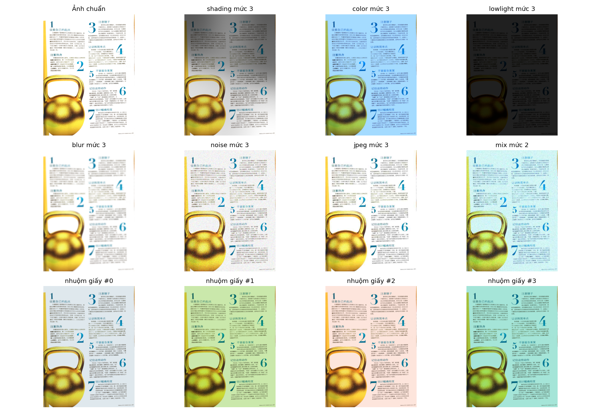

*Hình 2. Một ảnh chuẩn, từng loại suy biến ở mức 3, một cấu hình hỗn hợp, và bốn ảnh nhuộm màu giấy (dùng ở mục 5.7).*

### 2.3. Các tập đánh giá

Không tập nào dưới đây được dùng khi train hoặc khi chọn checkpoint.

| Tập | Ảnh | Ảnh chuẩn | Ghi chú |
|---|---|---|---|
| RealDAE test | 150 | ảnh chuẩn đi kèm | cạnh dài 1024 px |
| Tổng hợp | 1.260 | ảnh sạch gốc | 7 loại × 3 mức × 60 ảnh (10 trang ESP32 test + 50 ảnh RealDAE test), seed cố định 123 |
| DocAligner | 130 | bản scan | ảnh chụp điện thoại, đã căn khớp với scan; thu về cạnh dài 1024 px |
| Jung | 87 | ảnh chụp dưới ánh sáng đều | bóng đổ của tay và vật che; có kết quả công bố của nhiều phương pháp trên đúng 87 ảnh này |
| ESP32 | 10 trang | bản scan | PSNR trên cả trang; CER trên 317 dòng chữ |
| DocUNet | 130 | bản scan | ảnh giấy cong, gập, nhăn; chỉ dùng để đo làm phẳng |

## 3. Phương pháp

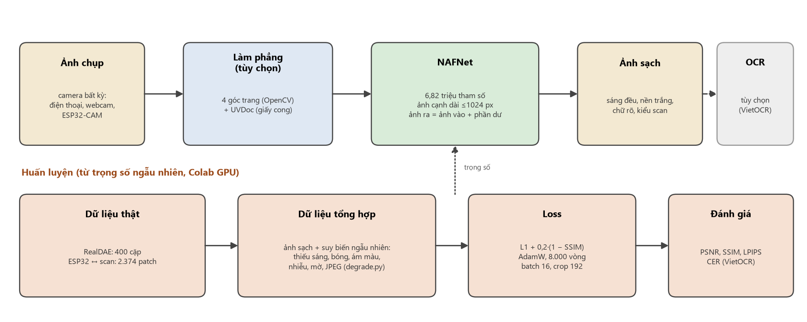

*Hình 1. Pipeline. Hàng trên: khi dùng. Hàng dưới: khi huấn luyện.*

### 3.1. Model: NAFNet bản nhỏ

NAFNet (Chen và cộng sự, 2022) là mạng kiểu U-Net dùng cho khử nhiễu và khử nhòe, bỏ các hàm kích hoạt phi tuyến thông thường để nhẹ và nhanh.

- **Cấu trúc:** U-Net 4 tầng, mỗi khối NAFBlock gồm LayerNorm, conv 1×1, conv depthwise 3×3, SimpleGate (nhân hai nửa kênh thay cho hàm kích hoạt), Simplified Channel Attention.
- **Học phần dư:** ảnh ra = ảnh vào + phần model dự đoán.
- **Kích thước:** bản dùng chính width 32 có 6,82 triệu tham số; bản lớn (M4-L) width 64 có 27,1 triệu.
- **Đối chứng kiến trúc:** một U-Net thường (7,76 triệu tham số) cùng loss và số vòng lặp.

### 3.2. Huấn luyện

| Thiết lập | Giá trị |
|---|---|
| Khởi tạo | trọng số ngẫu nhiên (không nạp checkpoint cũ) |
| Loss | L1 + 0,2·(1 − SSIM) |
| Tối ưu | AdamW, lr 1e-3, 500 vòng warmup rồi cosine |
| Số vòng | 8.000 (M4-L: 16.000) |
| Batch, crop | 16, 192×192 (M4-L: 32, 256×256) |
| Độ chính xác | bf16 |
| Chọn checkpoint | PSNR cao nhất trên val ảnh thật (trung bình các nguồn) |
| Phần cứng | Colab, GPU NVIDIA L4 (đợt 1), RTX PRO 6000 (M4 seed 1, M4-L), A100 40 GB (đợt 2 M5) |

Mỗi mẫu train chọn một nguồn, cắt ngẫu nhiên và lật. Với ảnh có sẵn ảnh vào thật, xác suất 0,5 thay ảnh vào bằng ảnh chuẩn bị làm hỏng tổng hợp. Một run M4 mất khoảng 12–37 phút tùy GPU.

### 3.3. Các model so sánh

| Mã | Phương pháp | Dữ liệu train |
|---|---|---|
| M0 | ảnh vào, không xử lý | – |
| M1 | cổ điển: cân bằng trắng, chia nền, NLM, CLAHE, unsharp (OpenCV) | – |
| R0 | NAFNet | chỉ ESP32 |
| M3 | NAFNet | chỉ RealDAE |
| M2 | U-Net | RealDAE + ESP32 + tổng hợp |
| **M4** | **NAFNet** | **RealDAE + ESP32 + tổng hợp** |
| M4-L | NAFNet width 64 | như M4, crop 256, batch 32, gấp đôi số vòng |

Hai phép so sánh chính: M2/M3/R0 với M4 cho thấy ảnh hưởng của kiến trúc và của dữ liệu.

### 3.4. Suy luận

- Ảnh cạnh dài ≤ 1024 px được xử lý nguyên ảnh. NAFNet dùng chú ý theo kênh (pooling toàn ảnh) nên chia ô nhỏ cho kết quả lệch: ô 256 px thấp hơn xử lý nguyên ảnh tới 12 dB, ô 512 px thì sát. Vì vậy dùng ô ≥ 512 px hoặc không chia ô.
- CPU: khoảng 1,7 giây cho ảnh 1024 px; GPU: dưới 0,12 giây (mục 5.8).

### 3.5. Làm phẳng (tùy chọn, chạy trước nâng ảnh)

Model nâng ảnh chỉ sửa màu và ánh sáng, không sửa hình học. Hai cách làm phẳng, đều trong `src/dewarp.py`:

- **4 góc:** tìm tứ giác trang lớn nhất bằng OpenCV rồi biến đổi phối cảnh. Sửa chụp nghiêng và cắt nền; không sửa giấy cong.
- **UVDoc** (Verhoeven và cộng sự, SIGGRAPH Asia 2023): model đã train sẵn (giấy phép MIT), dự đoán lưới 2D 45×31 rồi kéo ảnh về phẳng. Không train lại.
- **Tự động:** cắt 4 góc khi trang chiếm dưới 60 % khung hình (ảnh còn nhiều nền), rồi luôn chạy UVDoc.

## 4. Cách đánh giá

- **PSNR** trên RGB, **SSIM** trên ảnh xám, **LPIPS** (mạng AlexNet; thấp hơn là tốt hơn). Hai chỉ số đầu dùng cùng một hàm khi train và khi test.
- **CER của OCR:** cắt từng dòng chữ của 10 trang ESP32 test (317 dòng) từ ảnh đã nâng, cho **VietOCR gốc (chưa fine-tune)** đọc, so với nhãn từ lớp text PDF. Chuẩn hóa vị trí dấu thanh ("hoà"/"hòa") trước khi chấm. **CER bỏ dấu** là CER sau khi xóa dấu thanh và dấu mũ ở cả nhãn lẫn kết quả; hiệu của hai số là phần lỗi riêng do dấu.
- **Độ phẳng:** trên ESP32, ghép điểm SIFT giữa ảnh đã làm phẳng và scan, khớp một phép đồng dạng, báo sai lệch còn lại (% chiều rộng). Trên DocUNet: MS-SSIM trên ảnh xám 598.400 px, và LD là độ dời trung bình của luồng quang học DIS từ scan sang ảnh ra. **LD và MS-SSIM cài lại bằng Python (bản gốc dùng MATLAB, SIFT Flow), nên không so trực tiếp với số trong các bài báo.**
- **Nhiễu giữa các lần train:** train lại M4 với seed khác cho PSNR lệch tới 0,2 dB (trên tập tổng hợp; 0,02 dB trên RealDAE và ESP32). **Chênh lệch giữa hai model dưới khoảng 0,3 dB được coi là ngang nhau.** M4 và M5 có 3 seed (mục 5.7b), phần lớn cấu hình còn lại chỉ có một seed.

## 5. Kết quả

### 5.1. Kết quả chính

PSNR (dB) / SSIM / LPIPS (thấp hơn là tốt hơn):

| Model | RealDAE test (150) | Tổng hợp (1.260, TB 21 ô) | ESP32 10 trang |
|---|---|---|---|
| M0 ảnh vào | 12,40 / 0,858 / 0,216 | 17,68 / 0,726 / 0,261 | 5,79 / 0,571 |
| M1 cổ điển | 17,77 / 0,886 / 0,177 | 14,97 / 0,753 / 0,292 | – |
| R0, chỉ ESP32 | 16,77 / 0,817 / 0,306 | 14,96 / 0,710 / 0,443 | **17,51 / 0,818** |
| M3, chỉ RealDAE | **26,63** / 0,966 / **0,045** | 19,62 / 0,791 / 0,211 | 16,31 / 0,760 |
| M2, U-Net | 25,77 / 0,965 / 0,061 | 23,42 / 0,896 / 0,153 | 17,38 / 0,813 |
| **M4, NAFNet** | 26,48 / 0,968 / 0,050 | 24,75 / 0,912 / 0,125 | 17,10 / 0,812 |
| M4 seed 1 | 26,49 / 0,969 / 0,049 | 24,60 / 0,908 / 0,127 | 17,29 / 0,814 |
| M4-L, width 64 | **27,31 / 0,971 / 0,045** | **27,83 / 0,942 / 0,082** | 17,05 / 0,812 |

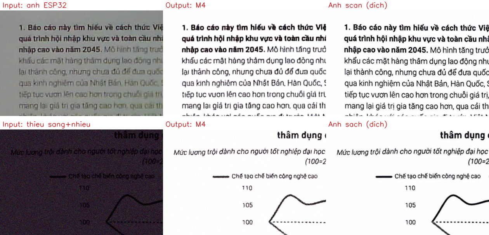

*Hình 3. Hàng trên: ảnh ESP32 (trái), M4 (giữa), bản scan (phải). Hàng dưới: ảnh thiếu sáng kèm nhiễu (tổng hợp), M4, ảnh sạch. Lưu ý dấu tiếng Việt ở hàng trên bị méo nhẹ ("hình" thành "hinh").*

**Nhận xét:**

- **Dữ liệu quan trọng hơn kiến trúc.** M3 (chỉ RealDAE) ngang M4 trên RealDAE (26,63 so với 26,48) nhưng thua 5,1 dB trên tập tổng hợp và 0,8 dB trên ESP32. R0 (chỉ ESP32) cải thiện PSNR RealDAE nhưng SSIM và LPIPS xấu hơn ảnh vào, và thấp hơn ảnh vào trên tập tổng hợp. Model train từ một nguồn không tổng quát sang nguồn khác.
- **M4 thấp hơn R0 0,4 dB trên ESP32** (17,10 so với 17,51) nhưng xử lý được thiếu sáng (23,9 dB so với 14,4 dB trên loại `lowlight`).
- **NAFNet hơn U-Net** cùng dữ liệu: +0,7 dB RealDAE, +1,3 dB tổng hợp.
- **Model lớn M4-L** cao hơn M4: +0,8 dB RealDAE, +3,1 dB tổng hợp (LPIPS tổng hợp 0,125 xuống 0,082), nhưng **không cải thiện ESP32** và gấp 4 lần tham số, khoảng 10 lần thời gian train. Chưa tách được phần lợi do model to hơn và phần do crop, batch, số vòng lớn hơn.
- **ESP32 kẹt quanh 17 dB** với mọi model train trên nhiều nguồn. Ảnh ESP32 độ phân giải thấp và mờ nên mất thông tin; chỉ 10 trang test.

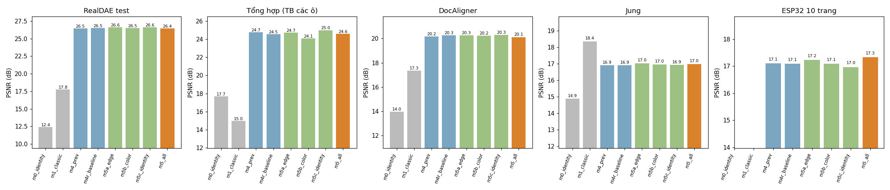

*Hình 4. PSNR trên từng tập test, các run đợt 2 và M4 đợt 1 (xem mục 5.7).*

### 5.1b. So với GCDRNet, một model đã công bố

GCDRNet (Zhang và cộng sự, IEEE TAI 2023) là bài đã giới thiệu bộ RealDAE. Mình chạy trọng số của tác giả (zero-shot, không train lại) bằng `src/run_gcdrnet.py`, rồi chấm cùng script `eval_sets.py` với cùng ảnh đầu vào như các model của đề tài. Để kiểm tra giao thức, mình chạy lại M4 trên 150 ảnh RealDAE bằng script này và được 26,48 dB, đúng số ở mục 5.1. Số công bố của GCDRNet là 24,42 dB; mình đo được 25,01 dB với cạnh dài 1024 px, cùng cỡ.

PSNR (dB) / SSIM:

| Tập | Ảnh vào | Cổ điển | GCDRNet | M4 (6,8 triệu tham số) | M4-L (27,1 triệu) |
|---|---|---|---|---|---|
| RealDAE test (150) | 12,40 | 17,77 | 25,01 / 0,949 | 26,48 / 0,968 | **27,31** / 0,971 |
| DocAligner (130) | 13,96 | 17,35 | 19,27 / 0,834 | **20,16** / 0,863 | 20,02 / 0,860 |
| Jung (87) | 14,87 | 18,36 | 16,57 / 0,829 | **16,89** / 0,851 | 16,50 / 0,827 |
| Tổng hợp (1.260) | 17,68 | 14,97 | 19,19 / 0,813 | 24,75 / 0,912 | **27,83** / 0,942 |

- **M4 hơn GCDRNet 1,5 dB trên RealDAE và 0,9 dB trên DocAligner.** Chênh 0,3 dB trên Jung nằm trong mức nhiễu giữa các lần train (mục 4), nên coi là ngang nhau. Về tốc độ CPU, GCDRNet nhanh hơn: khoảng 0,7 giây so với 1,7 giây của M4 cho ảnh 1024 px (đo trên cùng máy, không cùng lúc nên chỉ lấy cỡ).
- **Điều kiện không ngang nhau.** M4 train trên RealDAE train, ESP32 và dữ liệu tổng hợp do đề tài sinh; dữ liệu huấn luyện của trọng số GCDRNet chưa được kiểm tra ở đây. Tập tổng hợp có các loại suy biến do chính đề tài thiết kế nên thiên về M4 (chênh 5,6 dB không nên đọc là chênh chất lượng kiến trúc). RealDAE và DocAligner là hai so sánh có ý nghĩa nhất.
- **GCDRNet yếu nhất ở thiếu sáng nặng** (`lowlight` 15,1 dB, M4 23,9 dB) và lỗi hỗn hợp (`mix` 14,4 so với 20,9 dB). Như các model của đề tài, nó kém ảnh vào ở `blur` (20,1 so với 22,3) và `jpeg` (22,4 so với 29,7).
- Chưa train lại GCDRNet bằng dữ liệu của đề tài, và chưa đo CER của nó trên ESP32, nên chưa tách được phần do dữ liệu và phần do kiến trúc.

Chi tiết và lệnh chạy ở `reports/results/gcdrnet/SUMMARY.md`.

### 5.2. Theo từng loại suy biến

PSNR (dB) trên tập tổng hợp, trung bình ba mức:

| Loại | M0 ảnh vào | M1 cổ điển | M2 | M4 | M4-L |
|---|---|---|---|---|---|
| `lowlight` | 4,51 | 16,01 | 22,01 | 23,90 | **29,46** |
| `shading` | 13,72 | 15,79 | 25,05 | 25,05 | **29,30** |
| `color` | 20,52 | 15,76 | 25,19 | 27,07 | **30,31** |
| `noise` | 23,54 | 14,24 | 24,23 | 27,79 | **30,40** |
| `mix` | 9,50 | 12,89 | 19,79 | 20,88 | **23,13** |
| `blur` | **22,32** | 14,64 | 21,68 | 21,83 | 23,59 |
| `jpeg` | **29,65** | 15,46 | 25,98 | 26,74 | 28,58 |

- Với lỗi nặng (thiếu sáng, bóng, ám màu, nhiễu), model cải thiện rất lớn, ví dụ thiếu sáng từ 4,5 lên 23,9 dB.
- Với `blur` và `jpeg`, ảnh vào đã gần sạch và **mọi model cỡ nhỏ làm kết quả xấu hơn ảnh vào** (M4: 21,8 so với 22,3; 26,7 so với 29,7). Model làm thay đổi ảnh vốn đã tốt. Mục 5.7 thử một cách sửa.
- Phương pháp cổ điển chỉ tốt hơn ảnh vào ở thiếu sáng, bóng và `mix`, và làm xấu mọi loại còn lại.

### 5.3. DocAligner: ảnh chụp điện thoại

130 ảnh, ảnh chuẩn là bản scan nền trắng (cùng kiểu với cách model được dạy). Ảnh được thu về cạnh dài 1024 px; thời gian đo trên CPU.

| Phương pháp | PSNR | SSIM | giây/ảnh |
|---|---|---|---|
| **M4 NAFNet** | **20,16** | **0,863** | 1,7 |
| M4-L width 64 | 20,02 | 0,860 | 4,9 |
| M2 U-Net | 19,98 | 0,858 | 1,0 |
| M3, chỉ RealDAE | 19,94 | 0,859 | 1,8 |
| M1 cổ điển | 17,35 | 0,810 | 0,8 |
| R0, chỉ ESP32 | 16,78 | 0,739 | 1,7 |
| M0 ảnh vào | 13,96 | 0,790 | – |

- M4 tăng 6,2 dB so với ảnh vào và hơn cổ điển 2,8 dB; M4 hơn ảnh vào ở 122/130 ảnh và hơn cổ điển ở 122/130 ảnh.
- **Các model train trên nhiều nguồn (M4, M4-L, M2, M3) ngang nhau** (cách nhau dưới 0,25 dB). M4-L chỉ hơn M4 ở 45/130 ảnh, nên trên ảnh thật ngoài RealDAE, bản nhỏ là đủ.
- R0 (chỉ ESP32) đạt 16,8 dB, kém cả cổ điển: không tổng quát sang ảnh điện thoại.

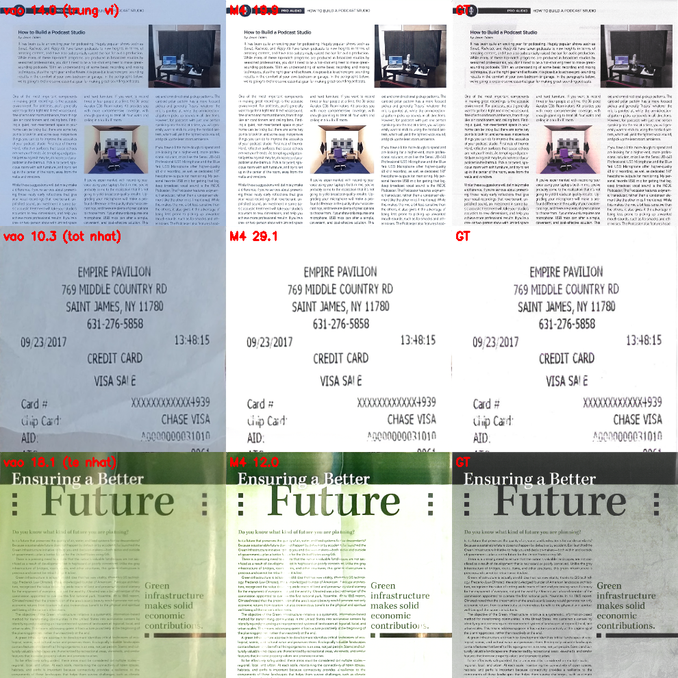

*Hình 5. DocAligner: ảnh trung vị (trên), tốt nhất (giữa, hóa đơn: 10,3 lên 29,1 dB), tệ nhất (dưới, trang nền xanh: 18,1 xuống 12,0 dB). Cột: ảnh vào, M4, ảnh chuẩn.*

### 5.4. Jung: bóng đổ

87 ảnh có bóng của tay. Gói dữ liệu có sẵn kết quả của các phương pháp đã công bố trên đúng 87 ảnh này; mọi phương pháp được chấm lại bằng cùng một script nên so sánh công bằng.

| Phương pháp | PSNR | SSIM |
|---|---|---|
| Water (công bố) | **23,38** | 0,904 |
| ImageJ rolling ball (công bố) | 20,76 | **0,910** |
| Inpaint (công bố) | 20,14 | 0,886 |
| Jung CVPR (công bố) | 19,04 | 0,830 |
| M1 cổ điển | 18,36 | 0,806 |
| **M4** | 16,89 | 0,851 |
| M4-L | 16,50 | 0,827 |
| R0 | 15,29 | 0,759 |
| M0 ảnh vào | 14,87 | 0,884 |

**M4 thấp hơn các phương pháp công bố, và lý do là lệch tông màu, không phải khử bóng kém.** M4 cho ảnh kiểu scan với nền trắng tinh (phân vị 90 của độ sáng là 255); ảnh chuẩn của Jung là ảnh chụp dưới ánh sáng đều với nền giấy xám nhạt (khoảng 233). PSNR phạt nặng độ lệch tông này trên toàn ảnh.

Kiểm chứng: học một đường cong tông màu chung (bảng tra 256 mức mỗi kênh) trên 20 ảnh rồi áp cho 67 ảnh còn lại (mỗi phương pháp một đường cong, không dùng ảnh chuẩn của 67 ảnh test):

| Phương pháp (67 ảnh) | PSNR gốc | PSNR sau chỉnh tông chung |
|---|---|---|
| Water | 23,40 | **24,95** |
| M4 | 16,92 | 24,44 |
| M4-L | 16,53 | 24,03 |
| ImageJ | 20,80 | 23,75 |
| Ảnh vào | 14,93 | 23,19 |

Sau khi bỏ lệch tông, M4 hơn ảnh vào 1,25 dB, hơn ImageJ, và kém Water khoảng 0,5 dB (Water do tác giả thiết kế cho đúng loại ảnh này). Riêng ảnh vào đã tăng từ 14,9 lên 23,2 dB chỉ nhờ chỉnh tông, nên **PSNR trên Jung chủ yếu đo tông màu**.

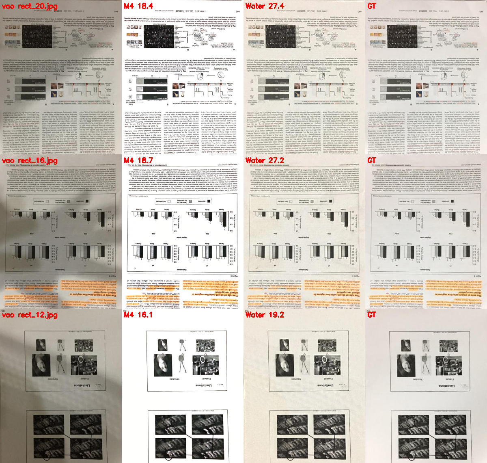

*Hình 6. Jung: ảnh vào, M4, Water và ảnh chuẩn.*

### 5.5. Ảnh nâng có giúp OCR đọc tốt hơn không (CER)

VietOCR gốc đọc 317 dòng của 10 trang ESP32 test:

| Phiên bản ảnh | CER | CER bỏ dấu | Lỗi riêng do dấu | Số dòng tốt hơn / kém hơn ảnh vào |
|---|---|---|---|---|
| Ảnh vào ESP32 | 21,0 % | 17,2 % | 3,9 | – |
| M1 cổ điển | 19,8 % | 15,9 % | 3,9 | 119 / 128 |
| **M4** | **13,7 %** | 8,7 % | 5,1 | 195 / 74 |
| M2 U-Net | 14,4 % | 10,3 % | 4,1 | 193 / 79 |
| R0, chỉ ESP32 | 12,4 % | 7,1 % | 5,3 | 203 / 56 |
| Bản scan (giới hạn trên) | 2,8 % | 2,6 % | 0,2 | 289 / 6 |

- **Nâng ảnh giảm CER 35 % tương đối** (21,0 xuống 13,7). Phương pháp cổ điển gần như không giúp (số dòng tốt hơn và kém hơn ngang nhau).
- **PSNR không phản ánh đúng độ dễ đọc.** M2 có PSNR cao hơn M4 trên ESP32 (17,4 so với 17,1) nhưng CER lại kém hơn; R0 có CER tốt nhất dù PSNR trên tập khác thấp.
- **Lỗi chữ cái giảm một nửa, lỗi dấu lại tăng.** CER bỏ dấu giảm từ 17,2 % xuống 8,7 %, nhưng phần lỗi riêng do dấu tăng từ 3,9 lên 5,1 điểm; có 25 dòng M4 đọc đúng hết chữ cái nhưng sai dấu ("Giới" thành "Giói", "với" thành "vỏi"). Model làm nét chữ sắc và đậm hơn nhưng dấu nhỏ (móc, huyền, sắc) bị làm mờ hoặc biến dạng (xem Hình 3).
- Còn cách xa bản scan (2,8 %): ảnh ESP32 có độ phân giải thấp và mờ nên mất thông tin.

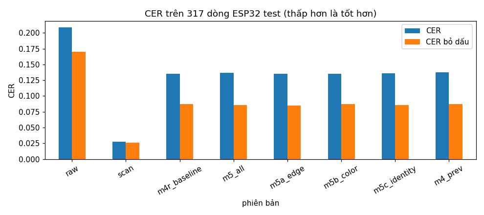

*Hình 7. CER của các phiên bản ảnh, tách lỗi chữ cái (xanh) và lỗi riêng do dấu (cam), đo ở đợt 2.*

### 5.6. Làm phẳng giấy cong

**DocUNet, 130 ảnh giấy cong, gập, nhăn** (MS-SSIM cao hơn là tốt, LD thấp hơn là tốt):

| Cách | MS-SSIM | LD (pixel) | giây/ảnh (CPU) |
|---|---|---|---|
| Không làm phẳng | 0,215 | 45,3 | – |
| 4 góc | 0,281 | 35,4 | 0,02 |
| 4 góc + UVDoc | 0,318 | 30,6 | 0,31 |
| **UVDoc** | **0,447** | **15,3** | 0,31 |
| Tự động | 0,440 | 16,9 | 0,29 |
| Chỉ M4, không làm phẳng | 0,192 | 44,0 | 1,9 |
| **UVDoc + M4 (đầy đủ)** | **0,451** | **12,7** | 2,4 |

- **UVDoc giảm LD khoảng 3 lần** (45,3 xuống 15,3) và tốt hơn ảnh vào ở 128/130 ảnh. Chỉ chạy M4 không giúp được ảnh cong, vì M4 không sửa hình học. Phần LD giảm thêm nhờ M4 một phần đến từ việc ảnh sạch hơn giúp luồng quang học ghép điểm dễ hơn.
- **Cắt 4 góc trước UVDoc chỉ có lợi khi ảnh còn nhiều nền.** Ảnh DocUNet đã cắt sát trang, trên trang cong cách 4 góc dễ bắt nhầm mép nên kết quả kém UVDoc một mình. Chế độ tự động dung hòa cả hai loại ảnh.

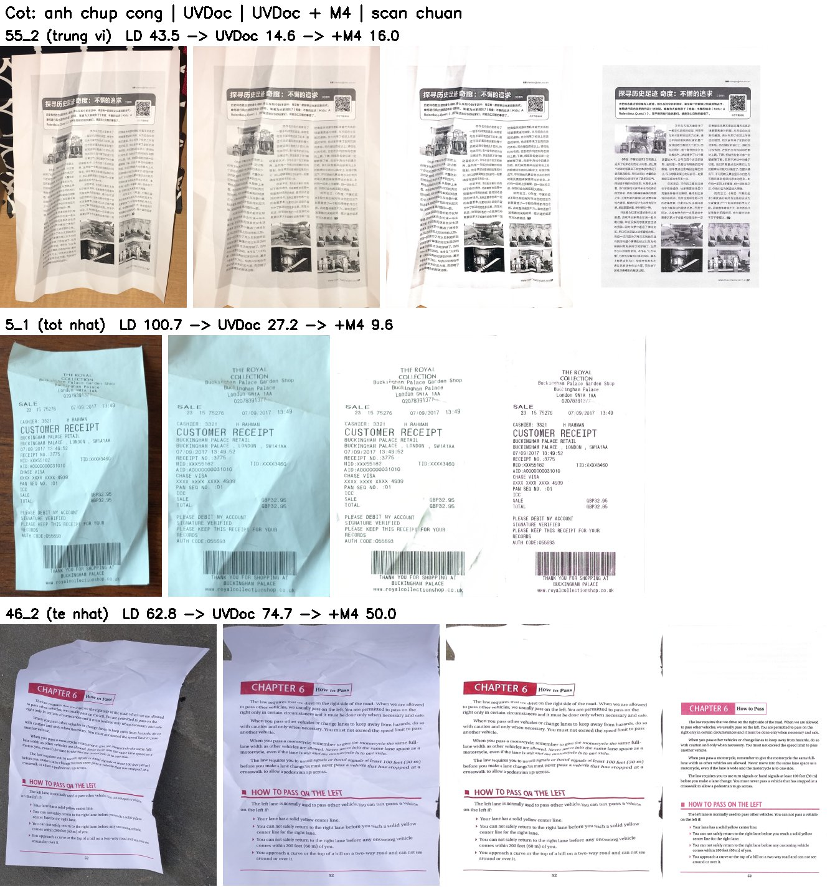

*Hình 8. DocUNet: ảnh chụp cong, UVDoc, UVDoc + M4, scan chuẩn. Hàng: trung vị, tốt nhất, tệ nhất theo LD.*

**ESP32, 10 trang gốc còn nền** (sai lệch so với scan sau phép đồng dạng, % chiều rộng):

| Cách | Trung vị | Phân vị 90 |
|---|---|---|
| Không làm phẳng | 0,13 | 0,54 |
| 4 góc | 0,27 | 0,69 |
| 4 góc + UVDoc | 0,71 | 1,83 |
| Chỉ UVDoc | 1,10 | 5,24 |

Trang ESP32 vốn phẳng và chụp thẳng (máy đặt cố định phía trên trang), nên làm phẳng không cải thiện hình học, và UVDoc còn làm méo nhẹ. Cách 4 góc cắt đúng trang ở cả 10 ảnh nên có ích để bỏ nền. UVDoc chạy thẳng trên ảnh còn nhiều nền cho mép trang lượn sóng (Hình 9). Vì vậy **bật làm phẳng chỉ khi giấy cong thật**; mặc định của demo là tắt.

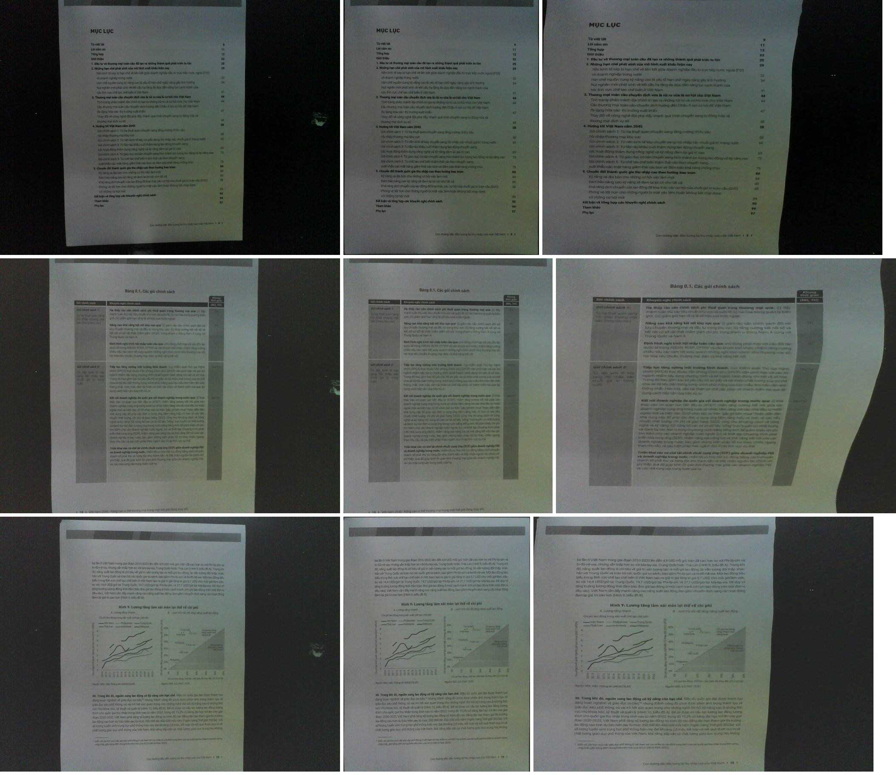

*Hình 9. Ảnh ESP32 gốc | 4 góc | UVDoc chạy thẳng.*

### 5.7. Đợt train thứ hai (M5): thử ba cải tiến

Từ các điểm yếu của M4 (mục 5.2, 5.3, 5.5), thử ba cải tiến, mỗi cái nhắm một lỗi:

| Điểm yếu của M4 | Cải tiến | Cờ |
|---|---|---|
| Dấu bị méo, lỗi dấu tăng | thêm loss L1 trên gradient Sobel của ảnh xám, giữ nét mảnh | `--edge-w 1.0` |
| Trang nền màu bị tẩy trắng | nhuộm màu giấy nhạt cho ảnh chuẩn trong luồng tổng hợp (xác suất 0,2) | `--paper-color 0.2` |
| Ảnh đã tốt bị làm xấu | thêm mẫu "ảnh sạch → ảnh sạch" (xác suất 0,1) | `--identity-p 0.1` |

Năm run, mỗi run train từ đầu, cùng thiết lập với M4: mốc chạy lại (`m4r_baseline`), từng cải tiến riêng, và cả ba (`m5_all`). PSNR (dB):

| Run | RealDAE | Tổng hợp | DocAligner | Jung | ESP32 |
|---|---|---|---|---|---|
| M4 chạy lại (mốc) | 26,49 | 24,54 | 20,26 | 16,90 | 17,08 |
| + loss gradient | 26,63 | 24,71 | 20,27 | 17,03 | 17,23 |
| + nhuộm giấy | 26,49 | 24,08 | 20,23 | 16,96 | 17,08 |
| + ảnh sạch | 26,60 | 24,97 | 20,31 | 16,92 | 16,97 |
| **M5 (cả ba)** | 26,44 | 24,59 | 20,12 | 16,99 | 17,33 |

Chênh lệch so với mốc: tối đa 0,24 dB ở các tập này, trừ hai ô trên tập tổng hợp (`+ nhuộm giấy` kém hơn 0,46 dB, `+ ảnh sạch` hơn 0,44 dB). Hai ô đó cũng chỉ có một seed, chưa lặp.

Ba phép thử riêng cho ba lỗi:

1. **Ảnh vốn đã sạch.** Đưa 60 ảnh scan sạch vào và đo ảnh ra so với chính nó (PSNR càng cao càng ít làm hỏng): mốc 28,26 dB; `+ ảnh sạch` **30,62**; M5 **30,03**; `+ loss gradient` 28,27; `+ nhuộm giấy` 27,79. **Cải thiện rõ nhất của M5**, khoảng 2 dB, nhưng model vẫn chưa trả ảnh nguyên vẹn.
2. **Trang nền màu.** Trên 3 ảnh nền màu của DocAligner (26_1, 26_2, 8_2): ảnh vào 16,69; mốc 11,42; M5 13,72; các bản riêng lẻ 11,2–11,6. Chỉ bản gộp cả ba khá hơn mốc (+2,3 dB) và nhìn bằng mắt M5 giữ màu xanh của trang 26_2 tốt hơn M4 (Hình 10). **Mới có 3 ảnh nên chưa kết luận được**, và mọi model vẫn kém ảnh vào trên 3 ảnh này.
3. **Dấu tiếng Việt.** CER do dấu (nhãn bỏ dấu và có dấu) của mọi run: 0,048–0,051, **cao hơn ảnh gốc (0,038)** và không khác M4 (0,049). Loss gradient không sửa được lỗi này. CER tổng của sáu phiên bản chỉ lệch nhau ≤ 0,002.


*Hình 10. Cột: ảnh vào, M4, M5, ảnh chuẩn. Hàng: trang nền xanh (DocAligner 26_2), trang điển hình, bóng đổ (Jung), chỉ mờ (tổng hợp), trang ESP32.*

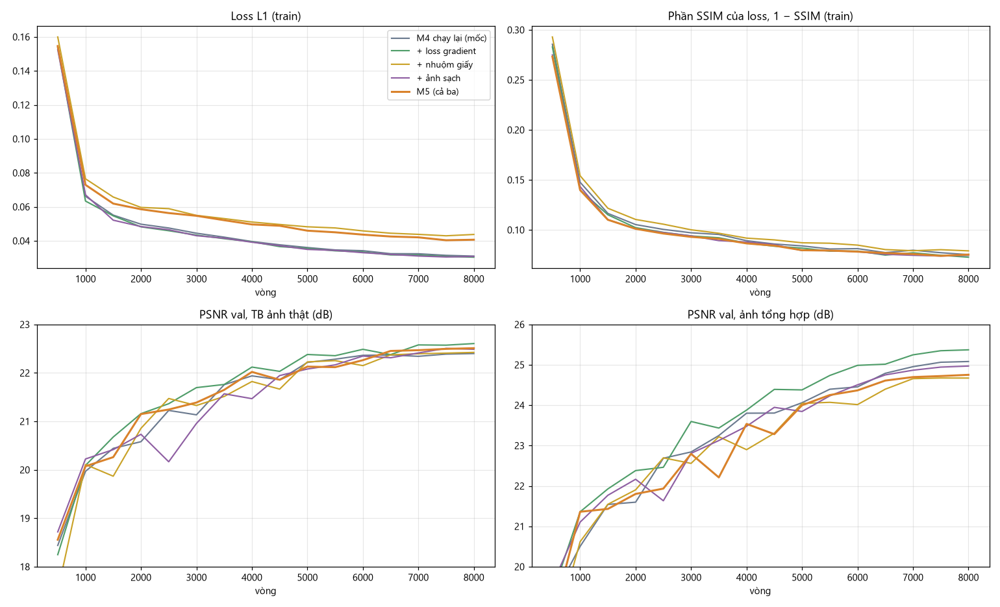

*Hình 11. Đường cong train của năm run đợt 2. Loss L1 của hai run có nhuộm giấy cao hơn (0,041 so với 0,031) vì ảnh chuẩn của chúng khác, không phải do học kém: PSNR val ngang nhau.*

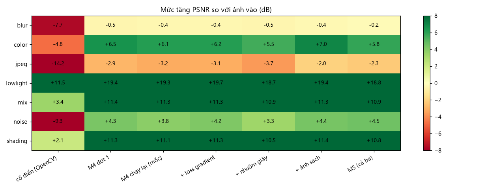

*Hình 12. Mức tăng PSNR so với ảnh vào trên tập tổng hợp, theo loại suy biến.*

**Kết luận sơ bộ của đợt M5 (một seed):** ba cải tiến không làm tốt hơn M4 đo được trên cả năm tập; chỉ `--identity-p` cải thiện rõ một lỗi (ảnh sạch). Mục 5.7b lặp lại với 3 seed để kiểm tra các kết luận này.

### 5.7b. Lặp lại với 3 seed và thử nhuộm màu giấy mạnh hơn

Để biết chênh lệch nào là thật, mình train thêm M4 và M5 (cả ba cải tiến) với seed 1 và 2, cùng cấu hình, mỗi cấu hình có đủ 3 seed (0, 1, 2). Thêm hai run thử nhuộm màu giấy với xác suất 0,5 thay vì 0,2: `m5d_color50` (cả ba cải tiến) và `m5e_color50_noedge` (không loss gradient), mỗi run một seed. Chạy trên Colab GPU A100 và L4.

PSNR (dB), trung bình ± độ lệch chuẩn qua 3 seed:

| Cấu hình | RealDAE | Tổng hợp | DocAligner | Jung | ESP32 |
|---|---|---|---|---|---|
| M4 (3 seed) | 26,45 ± 0,05 | 24,45 ± 0,11 | 20,21 ± 0,05 | 16,86 ± 0,04 | 17,15 ± 0,06 |
| M5, cả ba cải tiến (3 seed) | 26,42 ± 0,04 | 24,43 ± 0,19 | 20,17 ± 0,04 | 16,89 ± 0,10 | 17,23 ± 0,09 |
| M5, nhuộm giấy 0,5 (1 seed) | 26,27 | 23,50 | 19,99 | 16,90 | 17,20 |
| Nhuộm giấy 0,5, không loss gradient (1 seed) | 26,19 | 23,73 | 20,15 | 16,87 | 17,08 |

**Hai phép thử riêng, từng seed:**

| Run | Ảnh sạch → ảnh sạch (dB) | 3 ảnh nền màu (dB) | CER | Lỗi riêng do dấu |
|---|---|---|---|---|
| Ảnh vào | – | 16,69 | 0,209 | 0,038 |
| M4 seed 0 / 1 / 2 | 28,26 / 27,98 / 27,61 | 11,42 / 11,61 / 11,26 | 0,136 / 0,139 / 0,143 | 0,049 / 0,049 / 0,051 |
| M5 seed 0 / 1 / 2 | 30,03 / 30,78 / 28,92 | 13,72 / 12,52 / 13,74 | 0,137 / 0,145 / 0,140 | 0,051 / 0,053 / 0,054 |
| Nhuộm giấy 0,5 | 29,24 | **14,32** | 0,145 | 0,051 |
| Nhuộm giấy 0,5, không loss gradient | 29,09 | 13,63 | **0,135** | **0,045** |

**Rút ra từ 3 seed:**

1. **M5 không tốt hơn M4 về PSNR trên cả năm tập.** Chênh trung bình dưới 0,1 dB, nhỏ hơn độ lệch chuẩn giữa các seed (đến 0,19 dB trên tập tổng hợp). Kết luận âm ở mục 5.7 được xác nhận.
2. **Ảnh vốn đã sạch: cải thiện thật.** Cả ba seed của M5 đều cao hơn cả ba seed của M4 (trung bình 29,9 so với 28,0 dB, hơn khoảng 2 dB). Dải của hai nhóm không chồng nhau (M4 27,6 đến 28,3; M5 28,9 đến 30,8). Trong 3 cải tiến chỉ có `--identity-p` được thiết kế cho lỗi này.
3. **Trang nền màu: cải thiện nhưng vẫn kém ảnh vào.** M5 trung bình 13,3 dB so với 11,4 dB của M4 (hơn khoảng 1,9 dB, cả ba seed của M5 đều cao hơn cả ba seed của M4). Nhuộm giấy 0,5 cho 14,3 dB, cao nhất. Tuy vậy mọi model vẫn thấp hơn ảnh vào (16,7 dB) trên 3 ảnh này, và với chỉ 3 ảnh thì con số này nhiễu theo từng ảnh. Cái giá của nhuộm giấy mạnh: PSNR tập tổng hợp giảm khoảng 0,7 đến 0,9 dB (23,5 so với 24,4), vì model học giữ màu nền nên lệch khỏi ảnh chuẩn trắng của tập này.
4. **Dấu tiếng Việt: không cải thiện.** CER và lỗi riêng do dấu của mọi run đều nằm trong khoảng 0,135 đến 0,145 và 0,045 đến 0,054, tức là cùng cỡ M4 (0,136 đến 0,143 và 0,049 đến 0,051), và vẫn cao hơn ảnh vào (0,038). Run `nhuộm giấy 0,5, không loss gradient` có lỗi dấu thấp nhất (0,045) nhưng chỉ một seed, nằm trong phạm vi dao động của các seed M4, nên không đủ để kết luận.

**Kết luận đợt M5 (3 seed):** M5 giữ nguyên chất lượng PSNR trên ảnh bị hỏng, giữ ảnh sạch tốt hơn khoảng 2 dB và giảm phần nào việc tẩy trắng trang nền màu; không sửa được lỗi dấu. Nếu cần chọn model để dùng, M5 không kém M4 ở chỗ nào đo được và tốt hơn ở hai điểm trên, nên là lựa chọn mặc định hợp lý.

### 5.8. Tốc độ và kích thước

| Model | Tham số | CPU, ảnh 1024 px | GPU, ảnh ≤ 1024 px |
|---|---|---|---|
| M1 cổ điển | – | 0,8 s | – |
| M2 U-Net | 7,76 M | 1,0 s | 0,04 s (L4) |
| **M4 NAFNet** | **6,82 M** | **1,7 s** | 0,11 s (L4), 0,04 s (RTX PRO 6000) |
| M4-L | 27,1 M | 4,9 s | 0,04 s (RTX PRO 6000) |
| UVDoc (làm phẳng) | – | 0,3 s | – |

CPU đo trên máy phát triển (Windows). Các GPU khác nhau nên không so trực tiếp giữa hai cột GPU.

## 6. Phân tích lỗi

1. **Dấu tiếng Việt bị méo** (mục 5.5). Model tối ưu L1 + SSIM trên cả ảnh nên ưu tiên nền và nét chữ lớn; dấu là các nét rất nhỏ chiếm ít điểm ảnh. Loss gradient (mục 5.7) không đủ để sửa.
2. **Trang nền màu bị tẩy trắng** (Hình 5). Dữ liệu ảnh chuẩn có nền trắng gần như tuyệt đối nên model coi màu nền là ám màu do ánh sáng. Đây là nguyên nhân các ảnh tệ nhất của DocAligner (giảm tới 6 dB).
3. **Ảnh đã tốt bị làm xấu** (blur, jpeg; mục 5.2). Giảm được khoảng 2 dB bằng mẫu "ảnh sạch → ảnh sạch" nhưng chưa hết.
4. **PSNR phụ thuộc kiểu ảnh chuẩn** (mục 5.4). Cùng model cho 16,9 dB hay 24,4 dB trên Jung tùy tông màu đích. Không nên so PSNR giữa các tập có ảnh chuẩn khác kiểu.
5. **ESP32 kẹt ở 17 dB.** Thông tin đã mất do độ phân giải thấp, và 10 trang test quá ít. CER (mục 5.5) phản ánh lợi ích thực tế tốt hơn PSNR.
6. **Giấy vò nhàu nặng** (ảnh 46_2 của DocUNet) vẫn còn dòng chữ lượn sóng sau UVDoc, và UVDoc làm méo nhẹ trang vốn đã phẳng.

## 7. Demo

`src/demo_app.py` (FastAPI) chạy một trang web:

```bash
.venv-ocr/Scripts/python.exe -X utf8 src/demo_app.py --port 8010
```

- tải ảnh lên bằng kéo thả, chọn tệp hoặc dán;
- chọn model (M4, M2, M4-L, cổ điển), kích thước xử lý, và kiểu làm phẳng (không, tự động, 4 góc, UVDoc);
- xem trước/sau bằng thanh kéo hoặc hai ảnh cạnh nhau, và tải ảnh đã nâng về;
- có sẵn các ảnh mẫu, kể cả trang nền xanh và trang giấy cong để minh họa giới hạn.

Trang cạnh dài 1024 px mất khoảng 2–3 giây trên CPU. Ảnh chỉ được xử lý trên máy chạy demo.

## 8. Hạn chế

- **Mới so với một model đã công bố cùng giao thức (GCDRNet).** M4 hơn GCDRNet 1,5 dB trên RealDAE và 0,9 dB trên DocAligner (mục 5.1b), nhưng GCDRNet chỉ chạy zero-shot với trọng số của tác giả, dữ liệu huấn luyện của hai bên khác nhau, và chỉ so trên PSNR/SSIM (chưa so CER). Các model mạnh hơn như DocRes (24,65 dB trên RealDAE theo số công bố của repo Recommendations-Document-Image-Processing) **chưa được chạy cùng giao thức**, nên không kết luận được M4 hơn chúng.
- **Số seed còn ít.** M4 và M5 có 3 seed (độ lệch chuẩn tới 0,19 dB), nhưng các model còn lại (M2, M3, R0, M4-L) và hai run nhuộm giấy 0,5 chỉ có một seed. Chênh lệch nhỏ hơn khoảng 0,3 dB không đáng tin; hai ô chênh 0,44–0,46 dB của các cải tiến riêng lẻ ở mục 5.7 chưa được lặp lại; bản gộp cả ba cải tiến đã được lặp 3 seed (mục 5.7b) và không cho thấy chênh PSNR.
- **Dữ liệu ESP32 nhỏ:** 45 trang của một tài liệu, 10 trang test.
- **Chỉ số cài lại:** LD, MS-SSIM trên DocUNet dùng luồng quang học DIS thay SIFT Flow, không so được với số công bố.
- **Chưa đánh giá bằng người** (so sánh ảnh trước/sau theo cảm nhận).
- **CER đo với bộ thư viện khác nhau giữa hai lần đo:** lần đo ở đợt 1 và đợt 2 dùng phiên bản thư viện VietOCR khác nhau (đợt 2 phải cài không ràng buộc phiên bản Pillow). CER của ảnh gốc lệch 0,002 giữa hai lần (0,2102 và 0,2087), không ảnh hưởng kết luận.
- **Giả định ảnh thấy đủ trang.** Hình học chỉ được xử lý ở mức làm phẳng tùy chọn.

## 9. Hướng phát triển

1. **Sửa lỗi dấu:** loss theo vùng chữ hoặc loss OCR (VietOCR đóng băng, đã có sẵn trong `train_restore.py` qua `--ocr-loss`), tăng độ phân giải xử lý, hoặc fine-tune VietOCR trên ảnh đã nâng (đề tài OCR cũ cho thấy fine-tune đưa CER dòng từ 21,0 % xuống 3,3 %).
2. **Dữ liệu nền màu:** thêm trang có nền màu thật vào ảnh chuẩn để model không tẩy màu có chủ ý.
3. **So sánh công bằng hơn:** train lại GCDRNet bằng đúng dữ liệu của đề tài (tách ảnh hưởng của dữ liệu khỏi kiến trúc), đo CER của GCDRNet trên ESP32, và chạy thêm DocRes cùng giao thức.
4. **Nhiều seed** cho các cấu hình chính, và tách rõ lợi ích kích thước model khỏi lợi ích của crop, batch, số vòng lớn hơn (M4-L).
5. **Làm phẳng tự động trong pipeline:** chỉ bật UVDoc khi phát hiện giấy cong.
6. **Thêm dữ liệu ESP32 thật** và chạy trên nhiều tài liệu để tăng độ tin cậy của số đo ESP32.

## Phụ lục A. Chạy lại

```bash
# Demo web
.venv-ocr/Scripts/python.exe -X utf8 src/demo_app.py --port 8010

# Chấm một tập ảnh {inp,gt}
.venv-ocr/Scripts/python.exe -X utf8 src/eval_sets.py --set <thư mục> --method model --ckpt models/retrain/m4_nafnet_all/best.pt --lpips --out ket_qua.json

# Làm phẳng rồi nâng ảnh
.venv-ocr/Scripts/python.exe -X utf8 src/dewarp.py --inp anh.jpg --out ra/ --method auto --enhance models/retrain/m4_nafnet_all/best.pt

# So sánh GCDRNet: chạy rồi chấm bằng cùng script (cần timm; trọng số tải từ OneDrive của tác giả)
.venv-ocr/Scripts/python.exe -X utf8 src/run_gcdrnet.py --set data/external/docaligner --out outputs/gcdrnet/docaligner --weights <thư mục có gcnet/ và drnet/>
.venv-ocr/Scripts/python.exe -X utf8 src/eval_sets.py --set data/external/docaligner --method pred --pred-root outputs/gcdrnet/docaligner --out ket_qua.json

# Đo làm phẳng
.venv-ocr/Scripts/python.exe -X utf8 src/eval_docunet.py
.venv-ocr/Scripts/python.exe -X utf8 src/eval_dewarp.py

# Train lại trên Colab (GPU): chạy notebooks/PBL6_Colab_Retrain.ipynb sau khi đưa
# notebooks/pbl6_pipeline_code.zip lên MyDrive/PBL6/code/
python notebooks/make_retrain_notebook.py
```

## Phụ lục B. Tệp chính

| Tệp | Nội dung |
|---|---|
| `src/restore_model.py` | NAFNet, U-Net, nạp checkpoint, suy luận |
| `src/train_restore.py` | huấn luyện nhiều nguồn dữ liệu, cờ M5 |
| `src/degrade.py` | sinh suy biến tổng hợp |
| `src/eval_sets.py`, `src/n2_eval.py` | PSNR/SSIM/LPIPS và CER |
| `src/dewarp.py`, `src/eval_dewarp.py`, `src/eval_docunet.py` | làm phẳng và đo làm phẳng |
| `src/run_gcdrnet.py`, `third_party/GCDRNet-main/` | chạy GCDRNet (trọng số tác giả) để so sánh |
| `src/demo_app.py` | web demo |
| `models/retrain/`, `models/retrain2/` | checkpoint đợt 1 và đợt 2 |
| `reports/results/` | kết quả JSON, CSV, SUMMARY của từng tập |
| `notebooks/PBL6_Ket_qua_retrain.ipynb` | notebook kết quả có đầu ra |
| `docs/NHAT_KY_TRAIN_LAI.md` | nhật ký chạy, sự cố, bảng đầy đủ |
